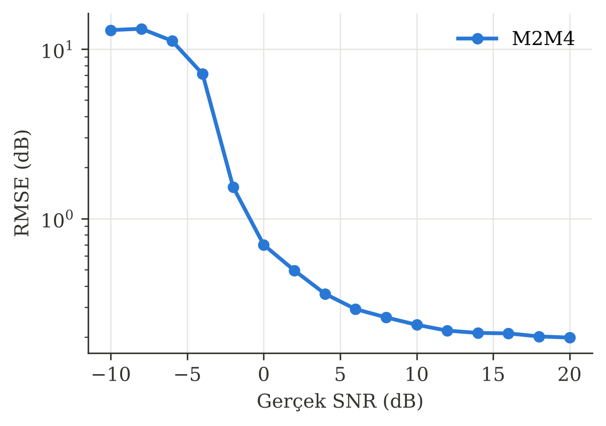
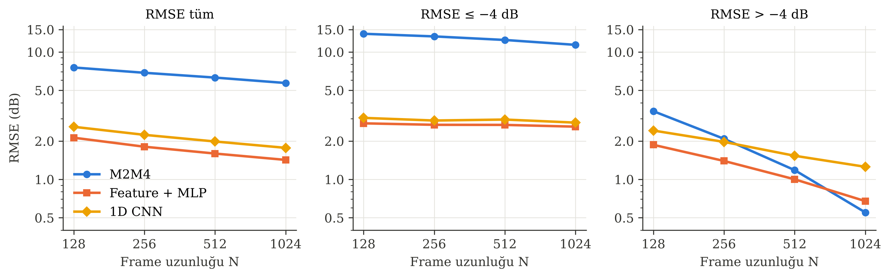
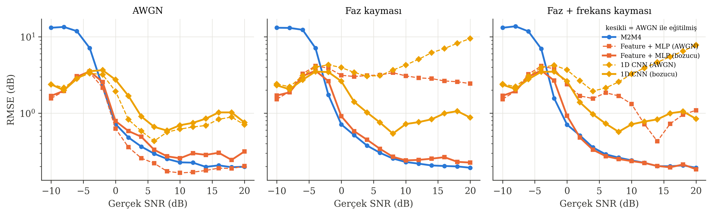

# Deep Learning ile SNR Tahmini

[](https://colab.research.google.com/github/rftbrkzkn/snr-estimation-dl/blob/main/notebooks/colab_runner.ipynb)

Alınan I/Q örneklerinden **SNR (Signal-to-Noise Ratio)** değerini derin öğrenme modelleriyle tahmin eden ve sonuçları klasik **M2M4** estimator ile **RMSE** üzerinden karşılaştıran çalışma.

Hedef: ders ödevi + konferans bildirisi.

---

## Problem

Bir haberleşme alıcısı, gelen sinyalin ne kadar "temiz" olduğunu (SNR) bilmek zorundadır. Adaptive modulation, güç kontrolü ve demodülasyon kararları bu bilgiye dayanır.

Klasik yöntemler (ör. M2M4) basit ve hızlıdır, ancak **düşük SNR**'da ve **kısa frame**'lerde hataları büyür. Bu çalışmada, aynı I/Q verisinden SNR'ı doğrudan öğrenen modellerin bu bölgelerde daha başarılı olup olmadığı incelenir.

---

## Yöntemler

| Yöntem | Girdi | Tür |
|---|---|---|
| M2M4 | Ham I/Q | Klasik (baseline) |
| Feature + MLP | Moment tabanlı öznitelikler | Hafif ML |
| MLP | Ham I/Q (düzleştirilmiş, 2N) | Deep learning |
| 1D CNN | I/Q, 2 kanal × N | Deep learning (ana model) |

---

## Deney Kurulumu

- **Modülasyon:** QPSK, birim ortalama güç
- **Kanal:** AWGN (sonraki aşamada faz / frekans kayması)
- **SNR aralığı:** −10 dB … +20 dB
- **Frame uzunluğu (N):** 128, 256, 512, 1024
- **Metrik:** RMSE (dB), bias (dB)

Ayrıntılı plan: [`docs/plan.md`](docs/plan.md)
Akış şemaları: [`docs/flowcharts.md`](docs/flowcharts.md)

---

## Klasör Yapısı

```
snr-estimation-dl/
├── src/
│   ├── config.py        # Tüm ayarlar tek yerde (SNR aralığı, N, seed…)
│   ├── data_gen.py      # QPSK + AWGN frame üretimi
│   ├── classical.py     # M2M4 estimator
│   ├── features.py      # Feature + MLP için öznitelik çıkarımı
│   ├── models.py        # MLP, 1D CNN
│   ├── train.py         # Eğitim döngüsü
│   ├── evaluate.py      # RMSE, bias, SNR bazlı metrikler
│   └── plots.py         # Bildiri kalitesinde figürler
├── docs/                # Plan, flowchart'lar, notlar
├── notebooks/
│   ├── colab_runner.ipynb  # İlk karşılaştırma (4 model, AWGN)
│   └── deneyler_v2.ipynb   # Deney 1–3: bildirideki sonuçlar
├── results/
│   ├── figures/         # Üretilen grafikler
│   └── tables/          # Sonuç tabloları (csv)
├── paper/               # Bildiri taslağı
└── data/                # Üretilen veri (git'e eklenmez)
```

---

## Kurulum

**Colab:** yukarıdaki **Open in Colab** butonuna tıkla, ilk hücreyi çalıştır.

**Lokal:**

```bash
pip install -r requirements.txt
```

---

## İlk Sonuçlar (N = 1024, AWGN)

| Yöntem | Parametre | RMSE tüm (dB) | RMSE ≤ −4 dB | RMSE > −4 dB |
|---|---|---|---|---|
| M2M4 | — | 5.71 | 11.38 | 0.55 |
| Feature + MLP | 4.8 k | **1.14** | **2.10** | **0.52** |
| MLP | 1.2 M | 9.36 | 12.05 | 8.27 |
| 1D CNN | 81 k | 1.40 | 2.42 | 0.81 |



Deney 1–3 sonuçları [`notebooks/deneyler_v2.ipynb`](notebooks/deneyler_v2.ipynb) ile üretildi
[](https://colab.research.google.com/github/rftbrkzkn/snr-estimation-dl/blob/main/notebooks/deneyler_v2.ipynb)

### Deney 2 — Frame uzunluğu (RMSE tüm, dB)

| N | M2M4 | Feature + MLP | 1D CNN |
|---|---|---|---|
| 128 | 7.56 | **2.13** | 2.59 |
| 256 | 6.87 | **1.81** | 2.24 |
| 512 | 6.30 | **1.60** | 1.98 |
| 1024 | 5.71 | **1.42** | 1.77 |



### Deney 3 — Robustness (RMSE tüm, dB, N = 1024)

| Yöntem | AWGN | Faz kayması | Faz + frekans kayması |
|---|---|---|---|
| M2M4 | 5.88 | 5.87 | 5.88 |
| Feature + MLP (AWGN ile eğitilmiş) | 1.43 | 3.01 | 2.10 |
| Feature + MLP (bozucu ile eğitilmiş) | 1.51 | **1.53** | **1.53** |
| 1D CNN (AWGN ile eğitilmiş) | 1.74 | 5.03 | 4.11 |
| 1D CNN (bozucu ile eğitilmiş) | 1.94 | 1.88 | 1.89 |



---

## Durum

- [x] Repo iskeleti
- [x] Colab notebook
- [x] Veri üreteci + constellation grafiği
- [x] M2M4 baseline + ilk RMSE vs SNR eğrisi
- [x] Feature + MLP
- [x] MLP
- [x] 1D CNN (ilk sürüm)
- [x] Frame uzunluğu deneyi
- [x] Robustness deneyi (faz / frekans kayması)
- [ ] Bildiri taslağı
